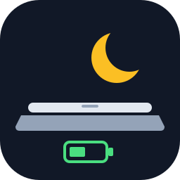
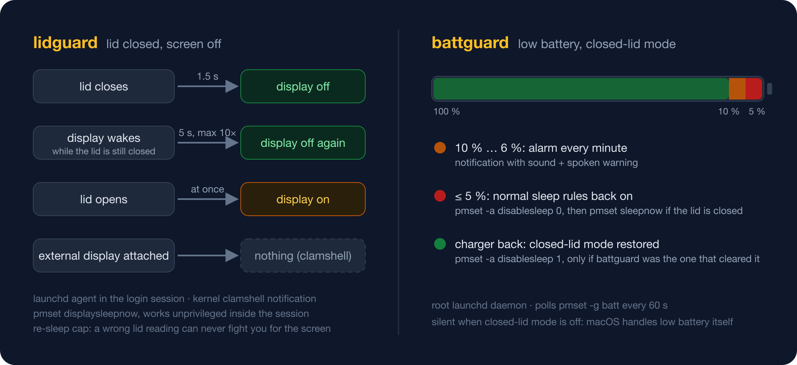

<p align="center"></p>

# battguard + lidguard

Two small guards for a MacBook that runs with the lid closed.

`sudo pmset -a disablesleep 1` keeps a Mac awake when the lid is shut, which
is handy for a laptop that doubles as a small server, build box or remote dev
machine. macOS does not clean up two side effects of that setting:

1. On battery the Mac never sleeps, so when the battery is empty it simply
   loses power.
2. The built-in panel stays lit at its current brightness after the lid is
   closed, until the `displaysleep` idle timer fires. On AC that can be hours.

**battguard** fixes 1, **lidguard** fixes 2. Both are tiny launchd jobs with no
dependencies beyond macOS itself; the Xcode Command Line Tools are needed once
to compile lidguard.

Tested on a MacBook Pro (M3 Pro) with macOS 26. Earlier macOS versions and
Intel Macs should work but have not been tried.

## battguard: low battery

A root launchd daemon runs `battguard` every 60 s. While closed-lid mode is on
and the Mac is on battery:

| battery      | action                                                          |
|--------------|-----------------------------------------------------------------|
| 10 % .. 6 %  | alarm each poll: notification with sound + spoken warning       |
| <= 5 %       | `pmset -a disablesleep 0`; `pmset sleepnow` if the lid is closed |
| charger back | `pmset -a disablesleep 1` again, only if battguard cleared it   |

When closed-lid mode is off, macOS handles low battery itself and battguard
stays silent. Levels: `BATTGUARD_WARN_AT` / `BATTGUARD_SLEEP_AT` (defaults
10 / 5), set in `battguard` or in an `EnvironmentVariables` dict of the plist.

## lidguard: lid closed, screen off

A launchd agent in your login session listens for the kernel's lid
notification (`kIOPMMessageClamshellStateChange`), so it reacts within
seconds without polling:

| event                                   | action                                                 |
|-----------------------------------------|--------------------------------------------------------|
| lid closed                              | `pmset displaysleepnow` 1.5 s later (display off)      |
| lid opened                              | declare user activity so the display wakes at once     |
| display wakes while the lid is closed   | sleep it again after 5 s, at most 10 times per close   |
| external display attached               | nothing (clamshell mode keeps working)                 |

The re-sleep cap means a wrong lid reading can never fight you for the screen.
The display wakes and locks like after any display sleep: if your Mac is set to
require a password after the display turns off, opening the lid shows the login
screen.

Tunables, as environment variables of the agent: `LIDGUARD_SETTLE` (1.5),
`LIDGUARD_RESLEEP` (5), `LIDGUARD_MAX_RESLEEPS` (10), `LIDGUARD_LOG`
(`~/Library/Logs/lidguard.log`).

## Install, status, remove

```
git clone https://github.com/karmahacker/battguard.git
cd battguard
sudo ./install.sh                 # battguard (root daemon) + lidguard (agent for the sudo user)
./install.sh --agent-only         # lidguard only, no root needed

sudo battguard --status
lidguard --status                 # installed to ~/bin/lidguard
tail /var/log/battguard.log ~/Library/Logs/lidguard.log

launchctl bootout gui/$(id -u)/local.lidguard    # stop lidguard until next login or install
sudo ./uninstall.sh               # both;  ./uninstall.sh --agent-only for lidguard alone
```

`install.sh` compiles lidguard with `swiftc` if the binary is missing or older
than the source. Nothing is downloaded.

## Testing

```
./test.sh
```

Runs the battguard scenarios in dry-run mode with fake battery, lid and flag
inputs, then builds lidguard and runs its decision-logic self-test, a `--status`
call and a short `--dry-run`. No root needed, nothing on the machine is changed.

## How it works, in short



- battguard is a bash script. It reads `pmset -g batt`, `pmset -g` and the
  `AppleClamshellState` from `ioreg`. Alarms are delivered into the console
  user's session with `launchctl asuser`. A state file remembers that battguard
  was the one that cleared `disablesleep`, so it only restores the flag when it
  should.
- lidguard is a single Swift file. It registers an IOKit interest notification
  on `IOPMrootDomain`, watches `NSWorkspace` screen-wake notifications, and
  runs `pmset displaysleepnow` (which works unprivileged inside the login
  session). The decision logic is a pure state machine with no side effects,
  which is what `lidguard --selftest` exercises.

## License

MIT, see `LICENSE`.
